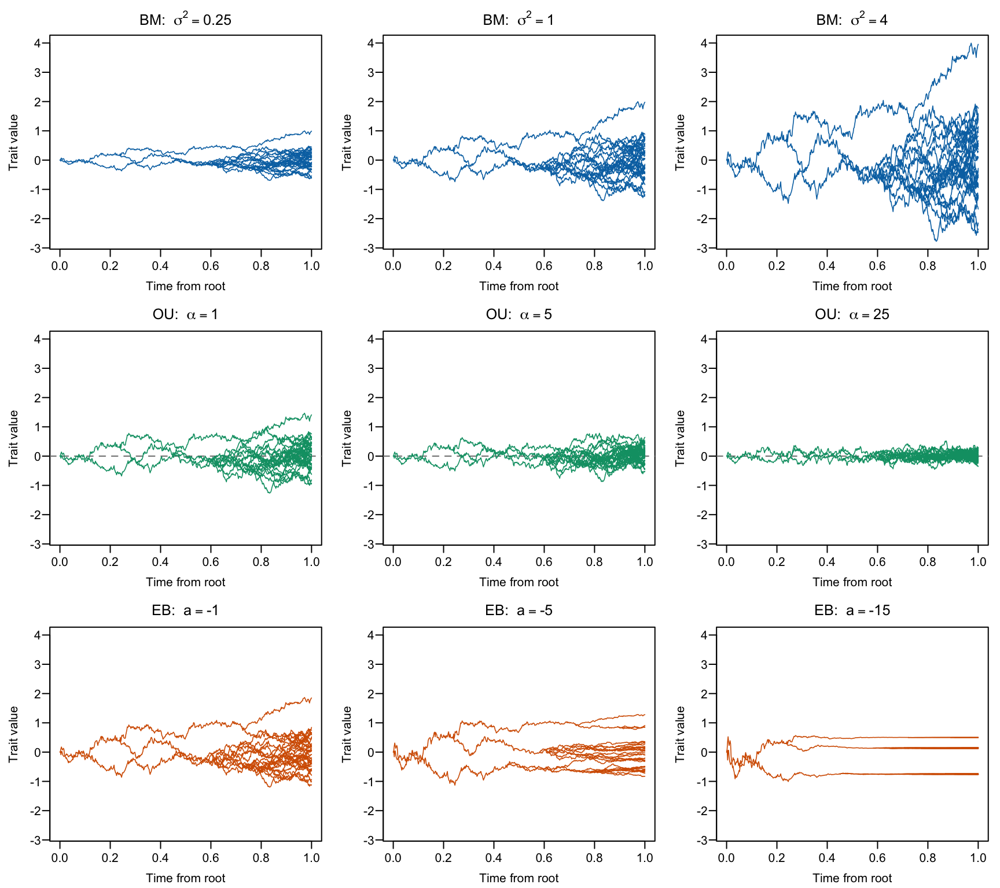
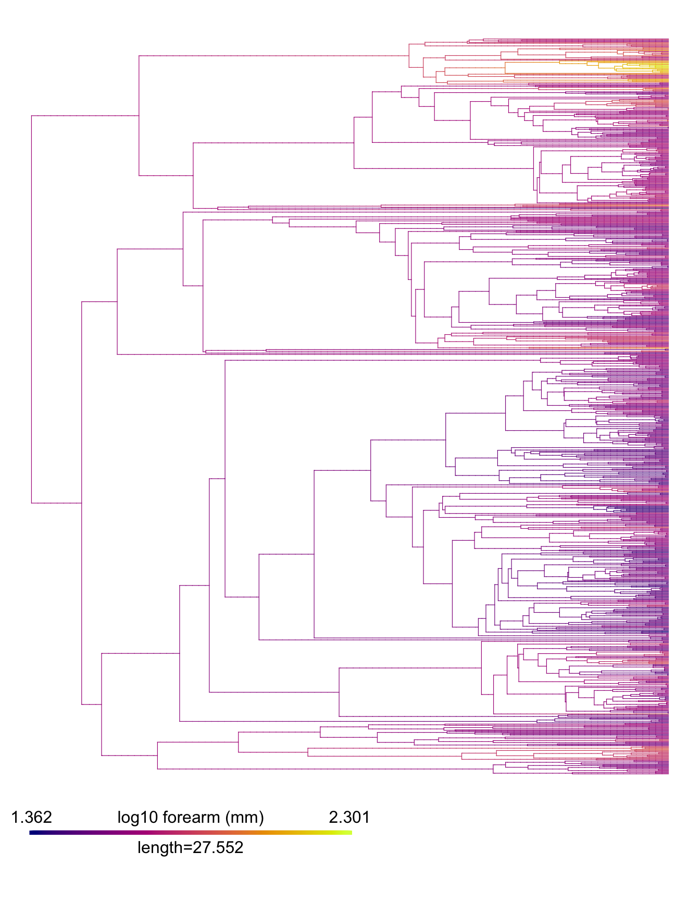
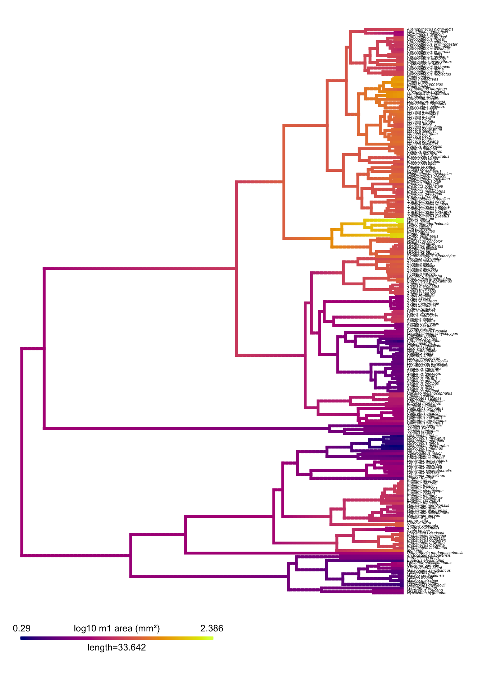

# Fitting models of trait evolution: BM, OU and EB

*Solutions* · [← Back to the student version](README.md)

## The three models

| Model | What it assumes | Extra parameter |
|---|---|---|
| **BM** (Brownian motion) | The trait wanders at random; variance grows steadily with time | none (rate σ² and root value z₀ only) |
| **OU** (Ornstein–Uhlenbeck) | The trait wanders, but is pulled back towards an optimum | α, the strength of the pull |
| **EB** (early burst) | Fast evolution early in the clade’s history that slows down through time | *a* (negative = slowing) |

The figure below shows what each model looks like. Each row is one model simulated on the same 40-species tree, and each line traces one lineage’s trait value from the root to the present. Across each row, the model’s main parameter changes.



*Trait histories simulated under BM (top), OU (middle) and EB (bottom).*

- **BM (top):** the spread between lineages grows steadily through time. σ² only sets how fast.
- **OU (middle):** lineages are pulled back towards an optimum (dashed line). As α increases, the pull gets stronger and lineages stay close to the optimum.
- **EB (bottom):** as *a* becomes more negative, most change happens early, near the root, and lineages barely change afterwards.

You will:

1. Fit **BM** to bat forearm length (worked example).
2. Fit **OU** and **EB** to the same data yourself, and compare the three models.
3. Repeat everything for primate molar size.

## Setup

```r
library(ape)
library(geiger)    # fitContinuous()
library(phytools)  # contMap()
```

There is one table and one tree for each group. The trees are already pruned to the extant species in the table, and the names already match. You can read the files straight from GitHub (as in the code below), or download them and read them from a local `data/` folder.

| File | Contents |
|---|---|
| [`bats_forearm.csv`](data/bats_forearm.csv) / [`bats_forearm.tre`](data/bats_forearm.tre) | Forearm length (mm), 835 bat species |
| [`primates_m1.csv`](data/primates_m1.csv) / [`primates_m1.tre`](data/primates_m1.tre) | Lower first molar (m1) crown area (mm²), 227 primate species |

## Part 1: Bats (worked example)

### Read the data

```r
url_data  <- "https://raw.githubusercontent.com/MachadoFA/Tutorials/main/Model%20Fitting/data/"
bats      <- read.csv(paste0(url_data, "bats_forearm.csv"))
bats_tree <- read.tree(paste0(url_data, "bats_forearm.tre"))
head(bats)
```

```
##                       species           family forearm_mm
## 1      Rhinopoma_microphyllum   Rhinopomatidae      68.08
## 2       Rhinopoma_muscatellum   Rhinopomatidae      49.99
## 3        Rhinopoma_hardwickii   Rhinopomatidae      59.50
## 4 Craseonycteris_thonglongyai Craseonycteridae      24.11
## 5                 Lavia_frons   Megadermatidae      56.00
## 6            Megaderma_spasma   Megadermatidae      56.49
```

```r
bats_tree
```

```
## 
## Phylogenetic tree with 835 tips and 834 internal nodes.
## 
## Tip labels:
##   Nycteris_macrotis, Nycteris_vinsoni, Nycteris_arge, Nycteris_madagascariensis, Nycteris_javanica, Nycteris_tragata, ...
## 
## Rooted; includes branch length(s).
```

`fitContinuous()` needs a **named vector**, with one value per species, named by species. We log-transform size so that change is measured in proportions, not millimetres.

```r
forearm <- setNames(log10(bats$forearm_mm), bats$species)
head(forearm)
```

```
##      Rhinopoma_microphyllum       Rhinopoma_muscatellum 
##                    1.833020                    1.698883 
##        Rhinopoma_hardwickii Craseonycteris_thonglongyai 
##                    1.774517                    1.382197 
##                 Lavia_frons            Megaderma_spasma 
##                    1.748188                    1.751972
```

### Look at the trait on the tree

```r
bats_map <- contMap(bats_tree, forearm, plot = FALSE)
bats_map <- setMap(bats_map, hcl.colors(100, "Zissou 1"))  # colour-blind-friendly
plot(bats_map, ftype = "off", outline = FALSE, lwd = c(0.6, 4),
     leg.txt = "log10 forearm (mm)")
```

<p align="center"></p>

### Fit Brownian motion

```r
bats_BM <- fitContinuous(bats_tree, forearm, model = "BM")
bats_BM
```

```
## GEIGER-fitted comparative model of continuous data
##  fitted 'BM' model parameters:
##  sigsq = 0.004180
##  z0 = 1.682324
## 
##  model summary:
##  log-likelihood = 329.306105
##  AIC = -654.612209
##  AICc = -654.597786
##  free parameters = 2
## 
## Convergence diagnostics:
##  optimization iterations = 100
##  failed iterations = 0
##  number of iterations with same best fit = 100
##  frequency of best fit = 1.000
## 
##  object summary:
##  'lik' -- likelihood function
##  'bnd' -- bounds for likelihood search
##  'res' -- optimization iteration summary
##  'opt' -- maximum likelihood parameter estimates
```

The output contains:

- **sigsq**: the evolutionary rate σ², in (log₁₀ mm)² per million years.
- **z0**: the estimated value at the root of the tree.
- **lnL**: the log-likelihood, which measures how well the model fits.
- **AICc**: the fit penalised by the number of parameters. **Lower is better.**

You can pull out single values like this:

```r
bats_BM$opt$sigsq
```

```
## [1] 0.004179785
```

```r
bats_BM$opt$aicc
```

```
## [1] -654.5978
```

On its own, an AICc value means nothing. It only becomes useful when we compare it with other models fitted to the **same data**. That is your job next.

### Your turn: fit OU and EB

Replace the blanks (`___`) with the right model names. Then compare the three AICc values.

```r
bats_OU <- fitContinuous(bats_tree, forearm, model = "OU")
bats_EB <- fitContinuous(bats_tree, forearm, model = "EB")

aicc <- c(BM = bats_BM$opt$aicc,
          OU = bats_OU$opt$aicc,
          EB = bats_EB$opt$aicc)
aicc - min(aicc)    # delta AICc: 0 = best model
```

```
##       BM       OU       EB 
## 425.6010   0.0000 427.6186
```

A useful rule of thumb: a ΔAICc **below 2** means the models are about equally good. A difference **above 10** is strong support for the better model.

**Questions**

1. Which model fits best? By how much?
2. Look at `bats_OU$opt$alpha`. The **phylogenetic half-life**, `log(2) / alpha`, is the time (in Myr) the trait takes to get halfway back to its optimum. Compare it with the age of the tree, `max(node.depth.edgelength(bats_tree))`. Is the pull strong or weak?
3. Look at `bats_EB$opt$a`. What value did it take? What does that tell you about EB compared with BM?

```r
half_life <- log(2) / bats_OU$opt$alpha
tree_age  <- max(node.depth.edgelength(bats_tree))
c(alpha = bats_OU$opt$alpha, half_life_Myr = half_life, tree_age_Myr = tree_age)
```

```
##         alpha half_life_Myr  tree_age_Myr 
##     0.1900849     3.6465131    55.1036000
```

```r
bats_EB$opt$a
```

```
## [1] -1e-06
```

**Answers**

1. **OU**, by several hundred AICc units, which is overwhelming support.
2. The half-life is only a few million years on a ~55 Myr tree. Forearm length “forgets” its ancestry quickly, so close relatives can be almost as different as distant ones.
3. *a* ≈ 0 (it prints as −1e-06, the upper limit `fitContinuous` allows). With *a* = 0 the rate never slows, so EB **is** BM. That is why its AICc is about 2 units worse than BM’s: it pays for an extra parameter it does not use.

## Part 2: Primates (on your own)

Now do the whole analysis yourself for primate **m1 area** (`m1_area_mm2`). Follow the same steps:

1. Read [`primates_m1.csv`](data/primates_m1.csv) and [`primates_m1.tre`](data/primates_m1.tre) (you can reuse `url_data` from Part 1).
2. Make a named vector of **log10** m1 area.
3. Plot it with `contMap()` and the same `setMap()` colours. With only 227 species you can show the names (try `fsize = 0.35`).
4. Fit BM, OU and EB, and compare their AICc.
5. Work out the OU half-life and check the EB parameter *a*.

```r
prim      <- read.csv(paste0(url_data, "primates_m1.csv"))
prim_tree <- read.tree(paste0(url_data, "primates_m1.tre"))
m1 <- setNames(log10(prim$m1_area_mm2), prim$species)
```

```r
prim_map <- contMap(prim_tree, m1, plot = FALSE)
prim_map <- setMap(prim_map, hcl.colors(100, "Plasma"))
plot(prim_map, fsize = c(0.35, 0.8), outline = FALSE, leg.txt = "log10 m1 area (mm²)")
```

<p align="center"></p>

```r
prim_BM <- fitContinuous(prim_tree, m1, model = "BM")
prim_OU <- fitContinuous(prim_tree, m1, model = "OU")
prim_EB <- fitContinuous(prim_tree, m1, model = "EB")

aicc <- c(BM = prim_BM$opt$aicc, OU = prim_OU$opt$aicc, EB = prim_EB$opt$aicc)
aicc - min(aicc)
```

```
##       BM       OU       EB 
## 0.000000 1.672287 2.054125
```

```r
c(alpha = prim_OU$opt$alpha,
  half_life_Myr = log(2) / prim_OU$opt$alpha,
  tree_age_Myr = max(node.depth.edgelength(prim_tree)),
  a = prim_EB$opt$a)
```

```
##         alpha half_life_Myr  tree_age_Myr             a 
##  5.134041e-03  1.350101e+02  6.728383e+01 -1.000248e-06
```

**Questions**

1. Which model fits primate molar size best? Is the support strong?
2. How does this compare with the bat result? Use the two `contMap` plots to suggest why.

**Answers**

- **BM fits best.** OU and EB are within about 2 AICc units of it, so neither earns its extra parameter.
- The OU half-life is longer than the age of the tree, so the pull towards an optimum is too weak to detect. EB’s *a* again sits at its limit (≈ 0), so EB collapses to BM.
- **Bats and primates differ.** Bat forearm length looks strongly “OU-like”. Primate molar size accumulates differences steadily with time, as BM predicts. Molar size differs mostly between major clades (e.g. great apes vs. marmosets), not between close relatives.

## Going further (optional)

Species means are not measured perfectly. Each one carries intraspecific variation and measurement error, and that noise can make OU look better than it really is. `fitContinuous()` can estimate this extra noise if you add `SE = NA`:

```r
fitContinuous(bats_tree, forearm, model = "OU", SE = NA)
```

Refit all three models with `SE = NA`, for both bats and primates. Does the best model change?
