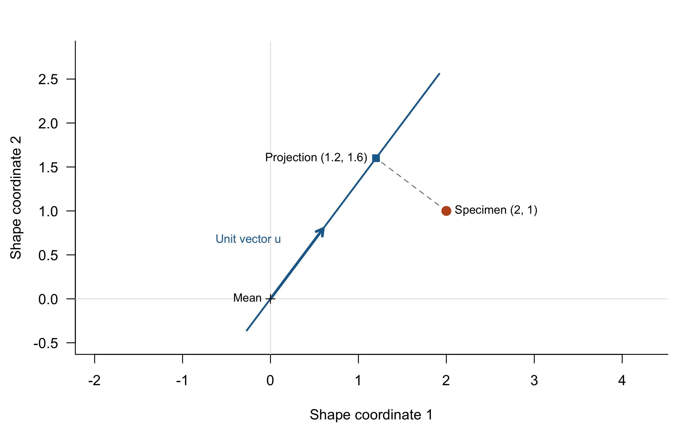
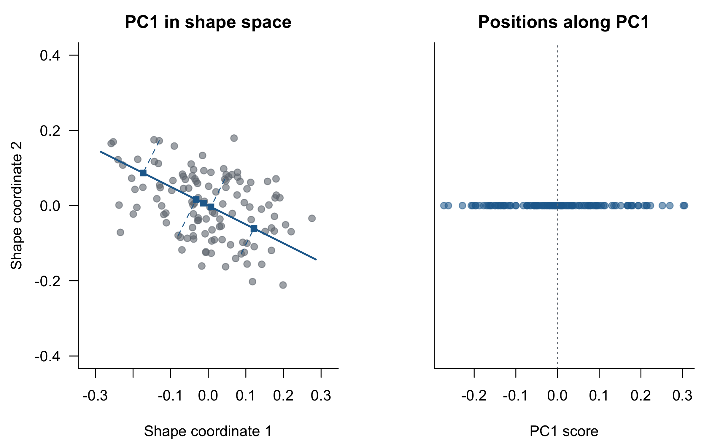
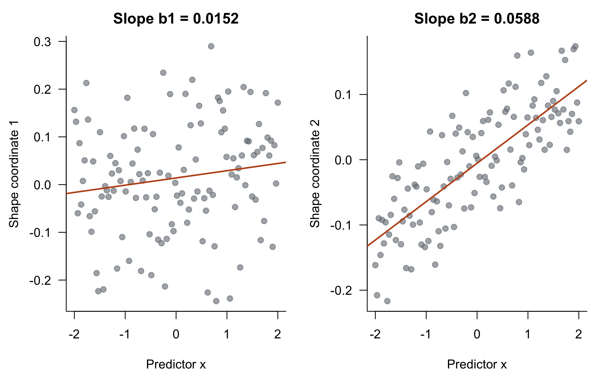
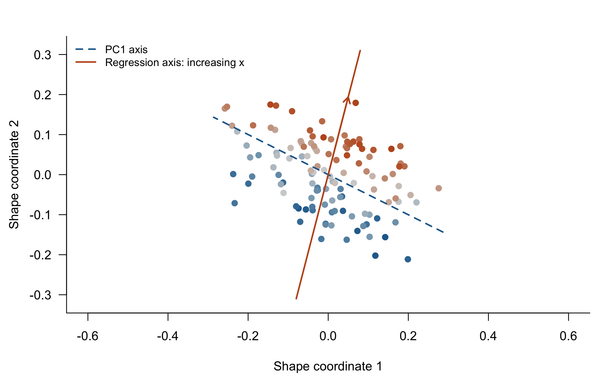
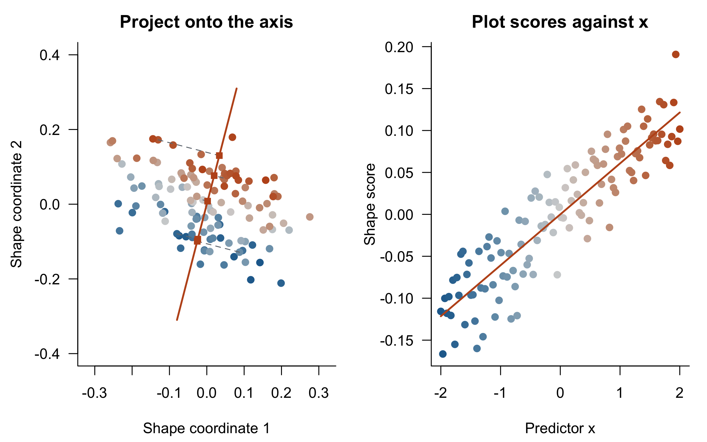
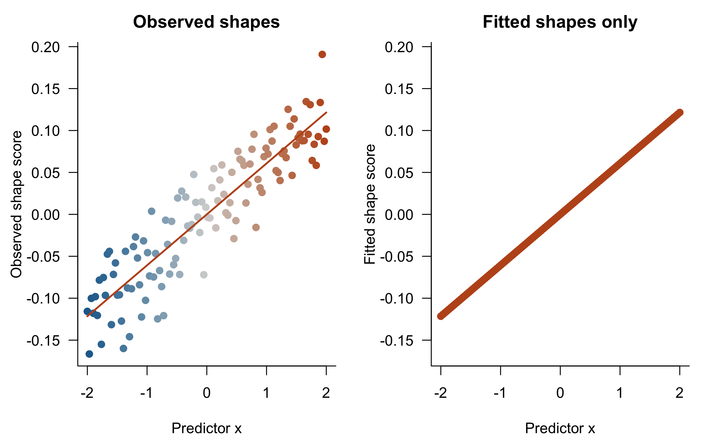

# Understanding shape scores in multivariate regression

### From a point in shape space to a score along a regression vector

*EMORPH2 · Methods tutorial*

## The idea we want to understand

A **shape score**, also called a **regression score**, is a specimen’s position along the direction of shape change estimated by a multivariate regression. The calculation is a projection: the same operation used to obtain principal component scores, but with a different rule for choosing the axis.

This tutorial builds that idea in five steps: represent a specimen as a point, project it onto an axis, choose an axis using PCA, choose another using regression, and calculate the score along the regression direction.

Drake and Klingenberg (2008) explicitly introduced this shape-score construction in their study of historical change in St Bernard skulls. MorphoJ uses the term *regression scores*. Here we focus on ordinary least-squares regression with **one continuous predictor and an intercept**. The predictor could be log centroid size, age, collection year, or an environmental measurement. The geometry below is a derivation of that model, rather than a separate statistical method.

## 1. A specimen is a point in a multivariate space

Imagine describing shape using just two coordinates, *y₁* and *y₂*. Each specimen has a pair of values, so we can draw it as a point. Two specimens differ in shape when they occupy different positions.

In geometric morphometrics, a specimen is instead represented by many aligned landmark coordinates. After generalized Procrustes alignment, we generally analyze these in a Euclidean tangent-space approximation. A centered specimen is a vector of deviations from the sample mean shape. The two-dimensional drawings below stand in for that much larger space; their axes are **abstract shape coordinates**, not raw skull length and width.

Let **Y** be an *n × p* matrix: specimens in rows and shape coordinates in columns. Subtracting the column means gives **Yc**. The mean shape is now at the origin, and the vector **yᵢ** points from that mean to specimen *i*.

Throughout, vectors in formulas are columns, so a specimen’s coordinates occupy a row **yᵢᵀ** of **Yc**. Redundant Procrustes coordinates do not prevent the projections or response regressions used here; neither requires inverting the shape covariance matrix.

## 2. Projection: a point becomes a score

Choose an axis through the origin. Describe its direction with a **unit vector u**, whose length is one. The scalar projection of a specimen onto that axis is

**sᵢ = yᵢᵀu**.

This is a dot product: multiply corresponding coordinates and add them. It gives a signed distance along the chosen axis. A positive score puts a specimen on the positive side of the mean; a negative score puts it on the opposite side. A score of zero means the specimen has no displacement along this axis, even if it differs from the mean in other directions.

The score is one number. The projected point in the original space is the vector **sᵢu**. These are two representations of the same projection.

### Work through one specimen

Take **y = (2, 1)ᵀ** and a direction **v = (3, 4)ᵀ**. The length of **v** is 5, so **u = (0.6, 0.8)ᵀ**. Then

**s = 2 × 0.6 + 1 × 0.8 = 2**.

The projected point is **su = (1.2, 1.6)ᵀ**. Notice that the score is neither the specimen’s first coordinate nor its distance from the origin. It is its signed position along this particular axis.

```r
par_default()
y <- c(2,1); u <- c(3,4)/5
s <- sum(y*u); projected <- s*u
plot(NA, xlim=c(-0.5,2.8), ylim=c(-0.5,2.8), asp=1,
     xlab="Shape coordinate 1", ylab="Shape coordinate 2")
abline(h=0,v=0,col="gray90")
segments(-0.45*u[1],-0.45*u[2],3.2*u[1],3.2*u[2],col=blue,lwd=2)
arrows(0,0,u[1],u[2],length=.09,col=blue,lwd=3)
segments(y[1],y[2],projected[1],projected[2],lty=2,col=gray)
points(y[1],y[2],pch=19,cex=1.4,col=orange)
points(projected[1],projected[2],pch=15,cex=1.2,col=blue)
text(y[1],y[2],"Specimen (2, 1)",pos=4,cex=.82)
text(projected[1],projected[2],"Projection (1.2, 1.6)",pos=2,cex=.82)
text(.22,.67,"Unit vector u",pos=2,cex=.82,col=blue)
points(0,0,pch=3); text(0,0,"Mean",pos=2,cex=.8)
```



*The dashed segment meets the chosen axis at a right angle. The projected point has two coordinates, but its position along the axis is summarized by one score: s = 2.*

**Why normalize?** Without dividing by the vector’s length, doubling the vector would double every score even though the axis had not changed. A unit vector separates the direction of the axis from the length of the vector used to describe it.

## 3. PCA chooses a direction of variation

In PCA, the first principal component is the direction along which the centered observations have the largest variance. Its loading vector **v₁** is a unit vector. The PC1 score for specimen *i* is

**PC1ᵢ = yᵢᵀv₁**.

PCA chooses the axis; projection gives the scores. PC2 uses the same calculation with another unit vector, perpendicular to PC1, that captures the greatest remaining variance.

### Simulate a shape space

We will use the same observations throughout the remaining tutorial. There are two abstract shape coordinates and one predictor, **x**. The simulation deliberately includes substantial shape variation perpendicular to the predictor’s effect, so the direction of greatest overall variation can differ from the regression direction. These are simulated Euclidean coordinates, not a landmark dataset.

```r
set.seed(42)
n <- 120
x <- seq(-2,2,length.out=n)
beta_true <- c(0.025,0.055)
u_true <- beta_true/sqrt(sum(beta_true^2))
u_perp <- c(-u_true[2],u_true[1])

# Predictor effect + noise along that direction + larger perpendicular noise.
Y <- outer(x,beta_true) +
     outer(rnorm(n,sd=0.028),u_true) +
     outer(rnorm(n,sd=0.14),u_perp)
colnames(Y) <- c("shape_1","shape_2")
Yc <- scale(Y,center=TRUE,scale=FALSE)
xc <- x-mean(x)

# Do not standardize shape coordinates to unit variance.
pca <- prcomp(Y,center=TRUE,scale.=FALSE)
v1 <- pca$rotation[,1]
pc1_score <- drop(Yc %*% v1)
stopifnot(isTRUE(all.equal(pc1_score,unname(pca$x[,1]))))
```

```r
par(mfrow=c(1,2),mar=c(4.3,4.4,2.4,1),las=1,bty="l")
lim <- max(abs(Yc))*1.16
L <- seq(-lim,lim,length.out=100)
plot(Yc,asp=1,xlim=c(-lim,lim),ylim=c(-lim,lim),pch=19,
     col=adjustcolor(gray,.6),xlab="Shape coordinate 1",
     ylab="Shape coordinate 2",main="PC1 in shape space")
lines(L*v1[1],L*v1[2],col=blue,lwd=2)
ii <- c(10,30,60,90,110)
PP <- outer(pc1_score,v1)
segments(Yc[ii,1],Yc[ii,2],PP[ii,1],PP[ii,2],col=blue,lty=2)
points(PP[ii,1],PP[ii,2],pch=15,col=blue)
plot(pc1_score,rep(0,n),pch=19,col=adjustcolor(blue,.55),
     xlab="PC1 score",ylab="",yaxt="n",ylim=c(-1,1),
     main="Positions along PC1")
abline(v=0,lty=3,col=gray)
```



*Left: the shape cloud and the PC1 axis. Right: the same specimens reduced to their signed positions along PC1. The axis is chosen without using x.*

The sign of a PC axis is arbitrary. Replacing **v₁** with **−v₁** reverses the scores but describes the same variation.

## 4. Regression also defines a direction

Now ask a different question: **how does expected shape change as x increases?** With both variables centered, the multivariate regression is

**yᵢ = b xᶜᵢ + eᵢ**,

where **b = (b₁, b₂, …, bₚ)ᵀ** is the vector of slopes. Each coordinate has its own slope, but together these slopes describe one direction of shape change. In the original coordinates the fitted shape is **ȳ + b(xᵢ − x̄)**.

For a single predictor, ordinary least squares gives

**b = Ycᵀxc / (xcᵀxc)**.

You can obtain the same vector by fitting a separate ordinary regression to each coordinate, always using the same predictor and specimens. There is no need to run PCA first.

```r
fit <- lm(Y ~ x)
b <- as.numeric(coef(fit)["x",])
b_length <- sqrt(sum(b^2))
stopifnot(b_length > 0)
u_reg <- b/b_length
b
```

```
## [1] 0.01515889 0.05881765
```

```r
par(mfrow=c(1,2),mar=c(4.3,4.4,2.4,1),las=1,bty="l")
for(j in 1:2){
  plot(x,Y[,j],pch=19,col=adjustcolor(gray,.6),xlab="Predictor x",
       ylab=paste("Shape coordinate",j),
       main=sprintf("Slope b%d = %.4f",j,b[j]))
  abline(coef(fit)[1,j],b[j],col=orange,lwd=2)
}
```



*Each regression has a slope. The pair of slopes gives the displacement in shape space associated with one unit of increase in x.*

Imagine increasing **x** by one unit. The fitted value of coordinate 1 moves by **b₁**, coordinate 2 by **b₂**, and so on. Draw those changes together as an arrow: that arrow is **b**. Increasing **x** again moves the fitted shape farther along the same line.

The vector’s **direction** describes the pattern of shape change. Its **length**, ‖b‖, gives the amount of fitted shape change per unit of **x**, in the chosen Euclidean metric. We normalize **b** to obtain the unit direction **uᵣ = b/‖b‖**.

### How is this like a PC axis?

Both are directions through the centered shape space, and both can be used for projection. Their rules for choosing the direction differ:

|  | PC1 | Regression direction |
|---|---|---|
| Question | Along which direction do shapes vary most? | In which direction does fitted shape change as x increases? |
| Uses x to choose the direction? | No | Yes |
| Unit direction | v₁ | b / ‖b‖ |
| Specimen score | yᵢᵀv₁ | yᵢᵀb / ‖b‖ |

PCA fits an axis by minimizing squared **perpendicular distances**. Regression fits expected shape at each observed **x**, minimizing squared residuals across the response coordinates. The regression direction is therefore not necessarily PC1, and it is not generally the linear combination of shape variables with the highest correlation with **x**; maximizing correlation is a different optimization problem.

```r
par_default()
cols <- colorRampPalette(c(blue,"#D4D4D4",orange))(n)
plot(Yc,asp=1,xlim=c(-lim,lim),ylim=c(-lim,lim),pch=19,col=cols,
     xlab="Shape coordinate 1",ylab="Shape coordinate 2")
lines(L*v1[1],L*v1[2],col=blue,lwd=2,lty=2)
lines(L*u_reg[1],L*u_reg[2],col=orange,lwd=2)
arrows(0,0,.20*u_reg[1],.20*u_reg[2],col=orange,lwd=2,length=.09)
legend("topleft",c("PC1 axis","Regression axis: increasing x"),
       col=c(blue,orange),lty=c(2,1),lwd=2,bty="n",cex=.85)
```



*The same shape space, with two different axes. Color marks the predictor from low (blue) to high (orange). PC1 follows the dominant variation; the regression axis follows the estimated change with x.*

## 5. The shape score is a projection onto the regression axis

We now have everything we need. Replace the PC loading vector with the normalized regression vector:

**sᵢ = yᵢᵀuᵣ = yᵢᵀb / ‖b‖**.

For all specimens at once:

**s = Yc b / ‖b‖**.

```r
shape_score <- drop(Yc %*% u_reg)
projection <- outer(shape_score,u_reg)
fitted_centered <- outer(xc,b)
fitted_score <- xc*b_length
```

Think of placing a ruler through the mean shape, pointing in the direction of the regression vector. Drop a perpendicular from each specimen onto the ruler. The position on the ruler is its shape score. Then plot those positions against **x**.

```r
par(mfrow=c(1,2),mar=c(4.3,4.4,2.4,1),las=1,bty="l")
plot(Yc,asp=1,xlim=c(-lim,lim),ylim=c(-lim,lim),pch=19,col=cols,
     xlab="Shape coordinate 1",ylab="Shape coordinate 2",
     main="Project onto the axis")
lines(L*u_reg[1],L*u_reg[2],col=orange,lwd=2)
segments(Yc[ii,1],Yc[ii,2],projection[ii,1],projection[ii,2],
         lty=2,col=gray)
points(projection[ii,1],projection[ii,2],pch=15,col=orange)
plot(x,shape_score,pch=19,col=cols,xlab="Predictor x",
     ylab="Shape score",main="Plot scores against x")
lines(x,fitted_score,col=orange,lwd=2)
```



*Left: observed shapes projected orthogonally onto the regression axis. Right: their scores plotted against x. The line is the score predicted by the multivariate regression, not a separate regression fitted to independent data.*

A high score means the specimen lies farther toward the shape associated with increasing **x**. It does not mean that the entire shape is well predicted, or that the specimen is anatomically closer to every high-**x** specimen. Differences perpendicular to the axis are absent from this plot.

Centering determines where zero lies. Projecting uncentered observations would add a constant to all scores, without changing their relative positions or the fitted slope.

## 6. Observed scores are not fitted scores

This is the crucial distinction. Substitute the regression equation into the score formula:

**sᵢ = (b xᶜᵢ + eᵢ)ᵀuᵣ = ‖b‖ xᶜᵢ + eᵢᵀuᵣ**.

The observed shape score contains two components:

1. **‖b‖ xᶜᵢ:** the position predicted by the regression.
2. **eᵢᵀuᵣ:** residual variation along the regression direction.

If you project only the **fitted shapes**, you retain only the first term. Those scores fall exactly on a straight line. The observed scores retain scatter because real specimens depart from their fitted positions along that line.

```r
par(mfrow=c(1,2),mar=c(4.3,4.4,2.4,1),las=1,bty="l")
yr <- range(c(shape_score,fitted_score))
plot(x,shape_score,pch=19,col=cols,ylim=yr,xlab="Predictor x",
     ylab="Observed shape score",main="Observed shapes")
lines(x,fitted_score,col=orange,lwd=2)
plot(x,fitted_score,pch=19,col=orange,ylim=yr,xlab="Predictor x",
     ylab="Fitted shape score",main="Fitted shapes only")
```



*Observed shapes give scores with scatter. Fitted shapes give scores exactly on a line. Use observed scores to visualize how specimens vary around the fitted relationship.*

### Two different points on the same axis

The orthogonal projection of an observed shape is **sᵢuᵣ**. The fitted shape at its predictor value is **b xᶜᵢ**. Both lie on the regression axis, but they need not occupy the same location. Their difference is the residual component along that axis.

Consequently, the multivariate residual **eᵢ** is not generally perpendicular to the regression axis. Ordinary least squares makes residuals orthogonal to the predictor across observations: **xcᵀE = 0**. It does not make each specimen’s shape residual perpendicular to **b**. That perpendicularity belongs to orthogonal projection, a different operation.

## 7. A convincing score plot can hide substantial shape variation

The score plot shows only one direction. A specimen can sit close to its predicted score while differing greatly from its fitted shape in perpendicular directions. Therefore, the proportion of variance explained in the score plot is generally different from the proportion of **total shape variance** explained by regression.

For this ordinary least-squares model, calculate both:

```r
E <- residuals(fit)
R2_shape <- 1-sum(E^2)/sum(Yc^2)
R2_score <- summary(lm(shape_score ~ x))$r.squared
round(c(total_shape_R2=R2_shape,score_plot_R2=R2_score),3)
```

```
## total_shape_R2  score_plot_R2 
##          0.237          0.819
```

Both calculations have the same fitted sum of squares, but the score plot has discarded all variation perpendicular to the regression axis. Its denominator is smaller. Thus, in this model, **R² for the score plot is at least as large as R² for total shape**. This follows from the projection geometry; it is not evidence that the regression explains more of shape than the multivariate calculation reports.

The axis was estimated using these same observations. A positive fitted slope is built into its orientation: the slope of centered scores on **x** is **‖b‖**. A conventional univariate *p*-value from subsequently regressing scores on **x** ignores this axis-estimation step and should not replace the multivariate test. A permutation test should refit the multivariate model for each permitted permutation; grouping, repeated measures, or phylogenetic dependence require an appropriate model and exchangeability scheme.

Score plots can reveal departures from linearity along the selected direction. They cannot reveal every nonlinear trajectory through shape space, especially one that bends mainly in perpendicular directions.

## 8. Apply the calculation to your own shape matrix

The minimal calculation below assumes that **Y** already contains aligned shape coordinates, with specimens in rows, and that **x** has exactly the same specimen order. Use the same Euclidean shape representation for fitting and projection. Do not standardize each coordinate independently: that changes the shape metric and the resulting direction.

```r
regression_shape_scores <- function(Y,x) {
  Y <- as.matrix(Y)
  if(!is.numeric(Y) || !is.numeric(x) || nrow(Y)!=length(x))
    stop("Use numeric shape coordinates and a matching numeric predictor.")
  if(anyNA(Y) || anyNA(x) || any(!is.finite(Y)) || any(!is.finite(x)))
    stop("Align specimens and resolve missing/nonfinite values before fitting.")
  if(nrow(Y)<3 || ncol(Y)<1 || var(x)==0)
    stop("Need at least three observations, shape coordinates, and varying x.")
  Yc <- scale(Y,center=TRUE,scale=FALSE)
  fit <- lm(Y ~ x)
  b <- as.numeric(coef(fit)["x",])
  length_b <- sqrt(sum(b^2))
  if(!is.finite(length_b) || length_b==0)
    stop("A zero regression vector has no direction to project onto.")
  u <- b/length_b
  list(score=drop(Yc %*% u),direction=u,beta=b,
       fitted_score=(x-mean(x))*length_b,
       mean_shape=colMeans(Y),fit=fit,
       R2_shape=1-sum(residuals(fit)^2)/sum(Yc^2))
}
result <- regression_shape_scores(Y,x)
stopifnot(isTRUE(all.equal(result$score,shape_score)))
```

For a GPA coordinate array with dimensions *landmarks × dimensions × specimens*, `geomorph::two.d.array(coords)` provides a specimen-by-coordinate representation. Keep its specimen order matched to the predictor. If you later reshape a direction into landmark displacements, preserve the coordinate ordering used by that conversion.

### What about using PC scores as the response?

You can express shape in PC coordinates without changing this geometry **if you retain the complete nonzero PC basis and do not standardize PC scores**. An orthonormal change of coordinates preserves lengths, angles, and projections. The shape scores obtained from regression in that complete PC space are the same, apart from numerical rounding, as those obtained from the original centered shape coordinates.

```r
pc_fit <- lm(pca$x ~ x)
b_pc <- as.numeric(coef(pc_fit)["x",])
s_pc <- drop(pca$x %*% (b_pc/sqrt(sum(b_pc^2))))
stopifnot(max(abs(s_pc-shape_score)) < 1e-10)
```

Retaining only a few PCs changes the analyzed space and can remove shape changes associated with **x**. A low-variance PC can still be important for the regression. PCA is helpful here as an analogy for projection, not a required preprocessing step.

### What changes with several predictors?

With a model such as **shape ~ size + age**, each coefficient vector describes a partial effect conditional on the other predictor. Projecting raw shapes onto the size vector also retains any age-associated variation that falls along that direction. For a partial-effect display, account for the other model terms consistently in the shapes and predictor, or display model predictions with those terms held at specified values. The one-predictor identities above should not be transferred unchanged to an unadjusted multiple-regression score plot.

## 9. Check your understanding

1. **If a specimen moves perpendicular to the regression axis, does its shape score change?** No. Its shape changes, but its dot product with the unit regression vector does not.
2. **Must PC1 and the regression vector point in the same direction?** No. The largest source of shape variation may be unrelated to the predictor.
3. **Why do observed scores scatter around their fitted line?** They include residual variation along the regression direction.
4. **Can two different shapes have the same score?** Yes. Their difference can lie entirely perpendicular to the axis.
5. **Can you reconstruct a specimen’s entire shape from its score?** No. Adding **sᵢuᵣ** to the mean reconstructs its projection, omitting perpendicular variation.
6. **What happens if you measure x in different positive units?** The slope-vector length changes, but its normalized direction and the shape scores stay the same. Reversing the sign of **x** reverses the direction and scores.

**The connection to remember:** a PC score is a projection onto a direction chosen to summarize variation. A regression shape score is a projection onto a direction chosen to describe fitted shape change with a predictor. The projection operation is identical.

## References and further reading

- Drake, A. G., & Klingenberg, C. P. (2008). The pace of morphological change: historical transformation of skull shape in St Bernard dogs. *Proceedings of the Royal Society B*, **275**, 71–76. [doi:10.1098/rspb.2007.1169](https://doi.org/10.1098/rspb.2007.1169). The original shape-score definition is in the methods.
- Klingenberg, C. P. (2016). Size, shape, and form: concepts of allometry in geometric morphometrics. *Development Genes and Evolution*, **226**, 113–137. [doi:10.1007/s00427-016-0539-2](https://doi.org/10.1007/s00427-016-0539-2). Broader context for shape regression and visualization.
- [MorphoJ User’s Guide: Regression](https://morphometrics.uk/MorphoJ_guide/covariation/regression.htm). Software documentation for regression scores, shape changes, and permutation tests.

## Reproduce this tutorial

Read the HTML version directly in a browser. All figures are embedded, and the equations use plain text so they remain available offline. Run `Shape_scores.R` in RStudio to reproduce the numerical calculations and figures with base R. The editable source is `Shape_scores.Rmd`; rendering it requires `knitr`, `rmarkdown`, and Pandoc (included with RStudio).
